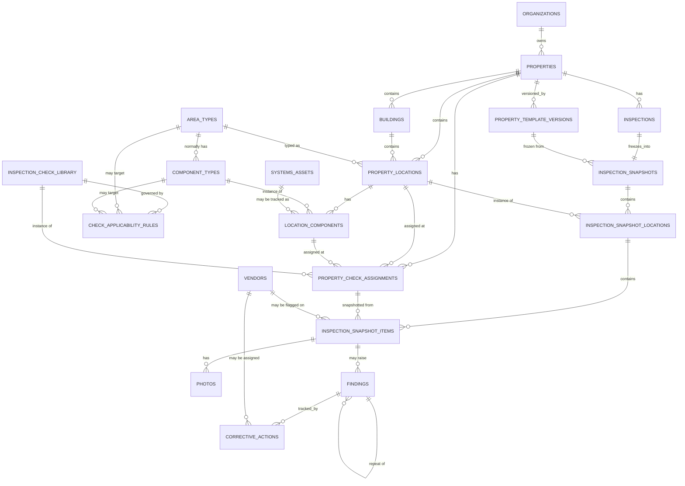

# Database Schema — Capex Inspection Pro

**Status:** Draft v0.2 — Phase 1, companion to `PRODUCT_SPEC.md`. Revises
v0.1 to add (1) a location-driven area/component/inspection-check
hierarchy in place of a flat section/item template, and (2) server-enforced
plan entitlement, device registration, and security infrastructure as MVP
requirements. No tables exist in Supabase yet.

## Conventions (unchanged from v0.1)

- Every tenant-scoped table has `organization_id` and an RLS policy
  restricting access to the caller's own organization.
- Every table has `id uuid primary key default gen_random_uuid()`,
  `created_at timestamptz default now()`, `updated_at timestamptz`.
- Lifecycle uses a `status` column rather than hard deletes, except for
  explicit administrator-only permanent-deletion paths.
- Client-generated UUIDs are used as primary keys for anything created
  offline, so sync is idempotent.
- **New convention for this revision:** any table whose row count is a
  plan entitlement limit (`properties`, `devices`) has `insert` **denied
  entirely** for the `authenticated` role. The only way to create a row is
  through a `SECURITY DEFINER` Postgres function or a server-side Edge
  Function using the service-role key, both of which perform the
  entitlement check and the insert inside one transaction. This is what
  makes the limit unbypassable by a fast client or a concurrent request —
  see "Entitlement Enforcement" below.

---

## Part A — Organizations, plan entitlement, devices, security

### organizations

`id`, `name`, `plan_tier` (`free` / `individual` / `professional` / `team` /
`enterprise`), `property_slot_limit` (int, `1` for free), `device_slot_limit`
(int, `1` for free), `user_seat_limit` (int, `1` for free),
`teammate_invites_allowed` (bool, `false` for free), `plan_limits_extra`
(jsonb — monthly inspections, storage, branded reports, analytics,
retention period; **not enforced in MVP**, reserved for later tiers),
`status` (active/archived), `created_at`.

The four explicit limit columns (as opposed to burying them in jsonb) are
deliberate: the entitlement-enforcing functions below read plain integer
columns under a row lock, which is simpler to reason about and audit than
parsing jsonb inside a security-critical transaction.

### profiles

`id` (= Supabase auth user id), `organization_id`, `full_name`, `email`,
`email_verified_at`, `role` (org_admin / portfolio_manager / supervisor /
inspector / viewer), `mfa_enrolled` (bool), `status`
(active/invited/disabled), `created_at`.

RLS: `profiles_select_own_org` (read anyone in your org) plus a single
`profiles_update_self_or_admin` UPDATE policy (migration `0020`) — a user
can update their own row, or an org admin can update anyone in their org.
The admin-role check goes through `current_user_is_org_admin()`, a
`SECURITY DEFINER` helper added in `0020` specifically so this check
doesn't read `profiles` from inside `profiles`' own policy — a raw
self-referencing subquery there caused Postgres to raise "infinite
recursion detected in policy for relation profiles" the moment any update
touched this table, a live bug since `0001` that had simply never been
exercised (nothing in the app updates `profiles` yet). See `0020`'s
migration comment and this file's Migration History entry for the full
writeup.

### devices

`id`, `organization_id`, `user_id`, `fingerprint_hash` (text — HMAC-SHA256
of an app-scoped identifier, computed server-side; **never** the raw
identifier), `play_integrity_verdict` (jsonb — last verified verdict +
timestamp + basic integrity/app-recognition/licensing signals only, not
raw device data), `status` (`active` / `revoked`), `registered_at`,
`revoked_at`, `revoked_reason`, `replaced_by_device_id` (nullable,
self-reference). Unique partial index on
`(organization_id, fingerprint_hash) where status = 'active'`.

**What this table intentionally does not contain:** IMEI, Android ID,
serial numbers, MAC addresses, or any other raw hardware identifier. The
only durable value stored is a one-way HMAC digest.

### security_events

`id`, `organization_id` (nullable — some events happen pre-org, e.g. a
rejected signup), `user_id` (nullable), `event_type` (`signup`,
`email_verified`, `login_success`, `login_failed`, `mfa_enrolled`,
`mfa_challenge_failed`, `device_registered`, `device_revoked`,
`device_replaced`, `password_reset_requested`, `rate_limit_triggered`,
`captcha_failed`, `play_integrity_rejected`, `property_slot_denied`,
`device_slot_denied`), `metadata` (jsonb — never raw hardware IDs or full
tokens), `ip_hash` (hashed, not the raw IP), `created_at`.

Kept separate from the general `audit_log` (below) because access to
security events is restricted to `org_admin` only, whereas `audit_log`
(business-data changes) is visible more broadly per the permission matrix.

### audit_log (unchanged in shape from v0.1)

`id`, `organization_id`, `actor_id`, `action`, `entity_type`, `entity_id`,
`before` (jsonb, nullable), `after` (jsonb, nullable), `created_at`. Now
also records: property-slot-limited creation attempts and outcomes,
device-replacement events (cross-referenced with `security_events`), and
critical-check status changes (see Part B).

## Entitlement enforcement (design, implemented in Phase 2/3)

**Property creation — `create_property()` (Postgres, `SECURITY DEFINER`):**

```sql
create or replace function create_property(p_org_id uuid, p_payload jsonb)
returns properties
language plpgsql security definer as $$
declare
  v_limit int;
  v_used int;
  v_row properties;
begin
  -- Row-level lock on the organization prevents two concurrent requests
  -- from both reading "0 used" and both inserting.
  select property_slot_limit into v_limit
    from organizations where id = p_org_id for update;

  select count(*) into v_used from properties
    where organization_id = p_org_id and status in ('active', 'archived');
    -- archived properties still consume the slot, by design

  if v_used >= v_limit then
    insert into audit_log(organization_id, actor_id, action, entity_type)
      values (p_org_id, auth.uid(), 'property_slot_denied', 'properties');
    raise exception 'property_slot_limit_reached';
  end if;

  insert into properties (organization_id, ...) values (p_org_id, ...)
    returning * into v_row;
  return v_row;
end; $$;
```

The `properties` table's own RLS `insert` policy is `false` for
`authenticated` — the **only** path to a new row is this function (or,
for hard administrative overrides, the service role directly). This means
the limit cannot be bypassed by calling the REST/`insert` endpoint
directly, and the `for update` lock closes the race condition where two
concurrent requests each see "0 of 1 used."

**Property archival vs. deletion (Phase 11, migration `0023`):**
Archiving (`status = 'archived'`) is a plain client-side `update()` — no
new function needed, since `properties_update_own_org`'s existing RLS
policy already allows an `org_admin`/`portfolio_manager` to change
`status`. Archiving deliberately still counts against
`property_slot_limit` (see `v_used`'s `status in ('active','archived')`
above), so it does not free a slot — it's meant as a reversible "hide
this" action, not a way to reclaim entitlement.

True hard deletion is `delete_property()`, a `SECURITY DEFINER` function
restricted to `org_admin` (stricter than archiving's two roles, since
it's irreversible) and gated on the property having **zero** rows in
`inspections` — once even one inspection has been recorded, the
property's areas/assets/checklist and that inspection's own snapshot
data are real history that a cascading delete (`property_locations`,
`systems_assets`, `property_check_assignments`, and `inspections` itself
all cascade `on delete` from `properties`) would destroy rather than
preserve. Archiving remains the only option at that point. A successful
delete does free a plan slot, since the row is actually gone from the
`v_used` count.

**Device registration/replacement — Edge Functions (`register_device`,
`replace_device`):**

These cannot be pure Postgres functions because they must (a) call
Google's Play Integrity API over HTTPS to verify the token, and (b)
compute the HMAC using a secret held only in server-side environment
config. Both run as Supabase Edge Functions using the service-role key
internally (never exposed to the client):

1. Client sends: the app-scoped identifier (see below), a Play Integrity
   token, and (for replacement) the current authenticated session.
2. Edge Function calls Google's Play Integrity verdict endpoint
   server-side and rejects the request if the verdict indicates a
   failed/unrecognized integrity check.
3. Edge Function computes `fingerprint_hash = HMAC-SHA256(app_scoped_id,
SERVER_SECRET)` — the app-scoped id itself is discarded after this,
   never stored.
4. Edge Function opens one transaction that: row-locks the organization
   (`register_device`) or the existing device row (`replace_device`),
   re-checks the entitlement/limit, and performs the insert/update —
   same atomicity guarantee as `create_property()`.
5. `replace_device` additionally: revokes the prior device row
   (`status='revoked'`, `revoked_reason='replaced'`), links it via
   `replaced_by_device_id`, sends a security-notification email, and
   writes a `security_events` row (`device_replaced`).

`devices` RLS `insert`/`update` is likewise `false` for `authenticated` —
only these Edge Functions (via service role) can write to it.

**App-scoped identifier:** on Android, this is an identifier that is
reset on uninstall/reinstall by design (that's what makes it
privacy-respecting rather than a persistent hardware ID) — practically,
Expo's application-instance identifier or an equivalent Firebase
Installation ID. This is a deliberate tension with "reinstall should not
grant a new slot," resolved by the reinstall behavior below rather than by
trying to make the identifier itself persistent.

**Reinstall / "new device" detection (per your decision):** reinstalling
the app generates a new app-scoped identifier, so a returning user's
fingerprint will no longer match their registered device. On the next
successful sign-in (valid credentials, plus MFA if enrolled), the backend
automatically runs the same transactional path as `replace_device` —
revoke old fingerprint, register new one, send a security-notification
email, write `security_events` + `audit_log` entries. The user experiences
this as an ordinary sign-in; the email is the safety net that surfaces an
unexpected replacement if it wasn't actually them. This does **not**
create a new property slot — property entitlement is scoped to the
organization, not the device, and is untouched by this flow.

**Free-plan abuse boundary vs. legitimate paid invites:** the
one-active-device rule and the fingerprint-reuse block are evaluated
specifically at **self-serve free-organization creation** and at
**device registration under a free-plan organization**. Accepting an
invite to an existing organization on a paid plan is a different
transactional path (`accept_invite()`, Phase 3) that checks
`user_seat_limit` and `teammate_invites_allowed` on that organization —
it never consults the free-plan device-fingerprint-reuse check, so a
device that already has one free account cannot be blocked from later
joining a teammate's paid organization.

**Implemented in migration `0022` + `supabase/functions/register-device`
(Phase 10), reconciling with the design above:**

- One combined function, `register_or_replace_device()`, handles both
  the `register_device` and `replace_device` cases above (same
  row-locked-organization transaction either way; which branch runs
  depends on whether the calling user already has an active device row)
  — not two separate functions. `revoke_device()` is a separate,
  ordinary `authenticated`-callable SECURITY DEFINER function for an
  org_admin revoking a device directly (no Play Integrity/HMAC step
  involved, so no Edge Function needed for that one).
- The Play Integrity verification step described above is real code in
  `register-device`'s `verifyPlayIntegrity()`, but it currently runs in
  a bypass mode rather than actually calling Google's endpoint — see
  that function's header comment and CHANGELOG.md's Phase 10 entry for
  the full reasoning (a native Android module and a Play Console/Google
  Cloud linkage neither exist yet). Every registered device's
  `play_integrity_verdict` honestly records `bypassed: true` rather than
  a fabricated "verified" result.
- The "sends a security-notification email" step is **not yet
  implemented** — PRODUCT_SPEC.md's own decision log already listed a
  transactional email provider as "not yet chosen," so there is nothing
  to send through yet. The `security_events`/`audit_log` rows this
  design calls for are written regardless — the email is the one piece
  still missing from the full picture.
- The app-scoped identifier is simply a random UUID generated once and
  stored in `expo-secure-store` (see `src/lib/device-registration.ts`),
  not a platform installation-id API — simpler, dependency-free, and it
  has the exact "resets on uninstall" property this design needs, since
  uninstalling the app clears SecureStore.

## Security requirements reflected in schema/design (implemented across Phases 2, 3, 6, 10)

- Verified email required before full access (`profiles.email_verified_at`
  gates permission checks).
- Signup, sign-in, and password-recovery rate limiting plus CAPTCHA/bot
  protection at the Supabase Auth layer (built-in rate limits + hCaptcha/
  Turnstile challenge on signup and recovery).
- Session tokens stored in platform secure storage (Keystore-backed) on
  device, never in plain files or `AsyncStorage`.
- Local SQLite inspection data and cached photos encrypted at rest, with
  the encryption key itself held in secure device storage (specific
  library choice — e.g. SQLCipher-compatible SQLite — finalized in
  Phase 6 alongside the offline sync build-out).
- Administrator (`org_admin`) MFA enrollment required (Supabase Auth
  TOTP), enforced at the RLS/application layer for admin-only actions.
- All Supabase Storage buckets (photos, reports) are **private**; access
  is only ever via short-lived signed URLs (minutes, not persistent
  public links).
- Row Level Security enabled and tested on every tenant-scoped table,
  including the new `devices` and `security_events` tables.
- Approved reports remain immutable (unchanged from v0.1).
- `security_events` gives a queryable audit trail for logins, device
  changes, and abuse signals; `audit_log` covers business-data changes.
- Session/device revocation: an `org_admin` can revoke a `devices` row
  (forcing re-registration) or force-expire a user's Supabase session.
- Backup restoration is tested procedure, not just a scheduled backup
  (see `TEST_PLAN.md`).

---

## Part B — Location-driven checklist hierarchy

Replaces the flat "global template → property template → snapshot" item
list from v0.1 with a compositional model:

**Organization → Property → Building → Area/Location → Component/Asset →
Inspection Check**

### Entity-relationship overview



### area_types

`id`, `organization_id` (nullable = platform standard library), `name`
(entrance, roof, exterior elevation, balcony, hallway, lobby, stairwell,
apartment/unit, basement, boiler room, mechanical room, electrical room,
elevator room, laundry room, garbage/compactor room, storage room,
sidewalk, yard, parking area, custom area), `description`, `is_custom`
(bool), `status`. **Data-driven, not hard-coded** — adding a new standard
area type is a data insert, not an app release.

### component_types

`id`, `area_type_id`, `organization_id` (nullable = platform standard),
`name` (e.g. under Roof: membrane, flashing, drains, strainers, parapets,
coping, bulkhead, skylight, chimney, walk pads, exhaust fans, rooftop
equipment — one row per component per area type per the full library in
`PRODUCT_SPEC.md`), `description`, `is_custom` (bool), `status`.

### property_locations (replaces v0.1's flat `locations`)

`id`, `property_id`, `building_id` (nullable), `area_type_id`,
`parent_location_id` (nullable, self-reference for a sub-location), `name`
(e.g. "Hallway — Floor 2", "Stairwell A", "Roof — Rear Extension"),
`floor` (nullable), `route_order` (int), `status` (active/inactive),
`created_at`. A property may contain any number of instances of the same
`area_type_id`. Each row has its own inspection history via
`inspection_snapshot_locations`.

### location_components

`id`, `property_location_id`, `component_type_id`, `asset_id` (nullable FK
to `systems_assets`, populated when the component is a discrete tracked
asset like a boiler rather than a structural feature like flooring),
`confirmed` (bool), `status` (active/inactive/replaced/not_applicable),
`notes`.

**Phase 12 change:** originally `confirmed` required an explicit tap per
component in a "confirm what's present" guided-setup step
(`ManageComponentsModal`, still present in the codebase but no longer
wired into that flow). Based on direct feedback that this added friction
without adding real control, the client now inserts every standard
component type for a location's area type with `confirmed: true` the
instant the location itself is created (`src/app/(app)/properties/[id]/setup.tsx`) —
no schema or RLS change, `location_components`' existing
`for all using (...org check...)` policy already allowed this from the
client. `generate_property_checklist()` (below) itself didn't need to
change either; it already only ever looked at `confirmed = true` rows,
there just used to be a manual step producing them.

### systems_assets (unchanged in shape from v0.1)

Full asset detail (manufacturer, serial number, service life, warranty,
PM frequency, next service date, certificate expiration, etc.) —
optionally linked from `location_components.asset_id` when a component
warrants full asset tracking.

### inspection_check_library

`id`, `organization_id` (nullable = platform standard library), `name`
(e.g. "Inspect for punctures, open seams, deterioration, and previous
temporary repairs"), `instructions`, `standard_status_options` (jsonb,
defaults to the 5 states), `photo_required` (bool), `comment_required`
(bool), `measurement_required` (bool), `measurement_unit`,
`acceptable_range_min`, `acceptable_range_max`, `default_priority`,
`default_department`, `frequency`, `critical` (bool — life-safety /
required-by-org, cannot be silently removed), `regional_tag` (nullable),
`seasonal` (bool), `status` (`active` / `inactive` / `not_applicable` /
`superseded`), `status_reason` (required when status is not `active`),
`status_changed_by`, `status_changed_at`, `superseded_by_check_id`
(nullable, self-reference), `version_number`.

Critical-check governance: an ordinary template edit can never hard-delete
or silently deactivate a row where `critical = true`. Any transition away
from `active` requires `status_reason` and is written to `audit_log`
(who, when, why); org-admin approval is required for critical-check
deactivation (enforced in the update path/RLS, not just the UI).

### check_applicability_rules

`id`, `inspection_check_id`, `area_type_id` (nullable), `component_type_id`
(nullable), `asset_category` (nullable), `inspection_type` (nullable),
`region_tag` (nullable), `season` (nullable), `frequency` (nullable),
`property_id` (nullable — property-specific override/inclusion rather
than a general rule), `rule_type` (`include` / `exclude`), `notes`. This
is what the generator evaluates to decide which checks apply where.

### property_check_assignments (the resolved, editable property checklist)

`id`, `property_id`, `property_location_id`, `location_component_id`
(nullable — some checks apply at the location level generally, e.g.
"general area cleanliness," without a specific component), `inspection_check_id`,
`source_rule_id` (nullable FK to `check_applicability_rules` — null if
manually added by a user rather than rule-generated),
`override_priority` (nullable), `override_department` (nullable), `status`
(`active` / `inactive` / `not_applicable` / `superseded`), `status_reason`
(required when not active), `created_by`, `created_at`. **Unique
constraint** on `(property_id, property_location_id, location_component_id,
inspection_check_id)` where `status = 'active'` — this is the
duplicate-prevention rule the generator relies on.

### property_template_versions

`id`, `property_id`, `version_number`, `assignments_snapshot` (jsonb —
frozen copy of the resolved `property_check_assignments` at the moment the
property checklist was activated/saved, for history and diffing),
`created_by`, `created_at`, `change_summary`, `status` (draft/active).

### inspections (header/scheduling record — mutable)

`id`, `organization_id`, `property_id`, `inspection_type`,
`assigned_inspector_id`, `scheduled_date`, `status`
(scheduled/in_progress/completed/postponed/voided), `scope_selection`
(jsonb — which buildings/locations were selected for this run, per the
inspection-type scope rules below), `created_at`, `completed_at`.

### inspection_snapshots (immutable freeze — 1:1 with inspections)

`id`, `inspection_id`, `property_template_version_id`, `generated_at`,
`generated_by`. This is what guarantees a later property-template edit
never alters an in-progress or completed inspection: the snapshot points
at a specific frozen version, not the live `property_check_assignments`.

### inspection_snapshot_locations

`id`, `inspection_snapshot_id`, `property_location_id`, `sequence_order`,
`status` (`pending` / `in_progress` / `complete` / `skipped` /
`inaccessible` / `not_applicable`), `status_reason` (**required** when
status is `skipped`, `inaccessible`, or `not_applicable`, or when an item
under it ends up `not_inspected`), `started_at`, `completed_at`.

### inspection_snapshot_items (replaces v0.1's `inspection_items`)

`id`, `inspection_snapshot_location_id`, `property_check_assignment_id`
(nullable if ad hoc), `inspection_check_id`, `title`/`instructions`
(copied at snapshot time), `location_component_id` (nullable), `status`
(satisfactory/deficiency/not_applicable/not_inspected/pending_verification),
`observation`, `recommendation`, `measurement_value`, `measurement_unit`,
`code_reference`, `priority`, `responsible_department`,
`responsible_person_id`, `vendor_id`, `access_status`, `access_plan`,
`target_completion_date`, `next_action`, `follow_up_date`,
`work_order_number`, `estimated_cost`, `actual_cost`, `labor_hours`,
`material_cost`, `inspected_at`, `is_ad_hoc` (bool),
`ad_hoc_approval_status` (nullable: pending/approved/rejected),
`client_uuid` (offline idempotent sync key), `sync_status`.

### photos / reports / audit_log

`photos` unchanged in shape from v0.1, except it now references
`inspection_snapshot_items.id` instead of the old `inspection_items.id`.
`audit_log` per Part A.

`reports` (Phase 7, migration `0021`): `id`, `organization_id`,
`inspection_id` (`unique` — exactly one report per inspection, no
versioning), `storage_path`, `approved_by`, `approved_at`, `created_at`.
Append-only — no update/delete policy exists at all, matching
`inspection_snapshots`' immutable-freeze pattern. The only write path is
`approve_report(p_inspection_id, p_storage_path)`, a `SECURITY DEFINER`
function: the client renders the PDF on-device, uploads it to the
private `inspection-reports` Storage bucket itself (same
`{organization_id}/{inspection_id}/{uuid}.pdf` path-prefix-checked RLS
shape as `inspection-photos`, restricted to org_admin/portfolio_manager/
supervisor on insert), then calls this function to record the row —
only once that succeeds does the report formally exist. The function
validates: caller is org_admin/portfolio_manager/supervisor
(`insufficient_permission`), the inspection exists in the caller's org
(`inspection_not_found`), its status is `completed`
(`inspection_not_completed`), no report already exists for it
(`report_already_approved`), and the given storage path is actually
under the caller's own org folder (`storage_path_invalid` — defense in
depth; the Storage insert policy already prevents the upload itself from
landing anywhere else). A read (`reports_select_own_org`) is open to
everyone in the org, same as photos — approving is the gated action,
viewing an approved report isn't. Verified against local Postgres 16 as
the real `authenticated` role: role gating, completed-only gating,
one-report-per-inspection, cross-org isolation on both the table and the
Storage bucket, and storage-path forgery are all covered — see
CHANGELOG.md's Phase 7 entry.

`storage.objects` RLS for the `inspection-photos` bucket (migration 0014) originally granted only `select`/`insert`/`delete`. Migration
`0018` added a matching `update` policy
(`inspection_photos_update_own_org`, same
`{organization_id}/...` path-prefix check as the others): Supabase
Storage's `.upload(path, bytes, { upsert: true })` takes an UPDATE path
internally when an object already exists at that path, and without an
`update` policy that UPDATE was silently rejected by RLS's default-deny
(`new row violates row-level security policy`) — hit in the field by a
photo retry whose first attempt had already landed in Storage before
being interrupted. See CHANGELOG.md's 2026-09-09 entry for the full
causal chain from the earlier `upsert: true` fix to this gap.

`photos.client_uuid`'s unique index (added in migration `0016`) was
originally declared _partial_ (`where client_uuid is not null`), which
Postgres cannot use as an `ON CONFLICT` inference target for the plain
`on_conflict=` PostgREST generates for `.upsert(..., { onConflict:
'client_uuid' })` — every photo upload failed at the insert step with
`42P10: there is no unique or exclusion constraint matching the ON
CONFLICT specification` until migration `0019` replaced it with a plain
unique index (a plain index doesn't weaken anything here: Postgres
already treats NULL as never equal to another NULL for uniqueness, so
pre-migration photos with `client_uuid` still null were never at risk).
`inspection_snapshot_items_client_uuid_idx` (migration `0011`) had the
same shape and was fixed the same way, even though nothing currently
upserts against it with an `onConflict` clause.

### vendors, findings, corrective_actions (Phase 5D)

`inspection_snapshot_items` already carries every deficiency _field_
captured at inspection time (priority, department, `vendor_id`,
`work_order_number`, costs, etc. -- see above). These three tables are
what's needed for the part that outlives a single inspection: a
corrective action's own lifecycle, which has to persist (and be
findable) long after the inspection that raised it is finished, and even
survive that inspection later being hard-deleted.

`vendors`: `id`, `organization_id`, `name`, `trade`, `contact_name`,
`phone`, `email`, `notes`, `status` (`active`/`inactive`). Plain CRUD
entity, managed directly (not through a function) by
org_admin/portfolio_manager/supervisor.

`findings`: the stable identity of one deficiency -- `id`,
`organization_id`, `property_id`, `inspection_id`,
`inspection_snapshot_item_id` (the last three all `on delete set null`,
**not** cascade, specifically so a finding survives a later
`delete_inspection()` call), `title`/`description`/`recommendation`/
`location_name`/`component_name` (denormalized copies taken at creation
time, not read live from the item), `priority`, `repeat_of_finding_id`
(self-reference, for a follow-up inspection to link back to a condition
it's re-checking), `resident_access_required`, `current_status` (the
full 12-value lifecycle from PRODUCT_SPEC.md section 10 -- kept as a live
mirror of the finding's corrective_actions via a trigger, so a board
screen never has to join out to filter by status), `escalated`/
`escalated_at`/`escalated_by`/`escalation_note`. One finding per source
item (partial unique index), so an item toggling in and out of
`deficiency` can't create duplicates.

`corrective_actions`: the actual remediation work -- `id`, `finding_id`,
`organization_id` (denormalized, same reasoning as `photos.organization_id`),
`status` (same 12-value lifecycle), `status_reason` (required when
`voided`), `assigned_to`, `vendor_id`, `access_notes`, `scheduled_date`,
`target_completion_date`, `completed_at`, `completion_notes`,
`verified_by`, `verified_at`, `estimated_cost`, `actual_cost`. Normally
one row per finding; a new row is how a voided/failed attempt gets
superseded by a fresh one without losing the first attempt's history.

Write path: both tables get a `select` policy only. A finding (and its
first corrective_action) is created automatically the moment an
inspector marks an item `deficiency` (`handle_item_deficiency()`, a
SECURITY DEFINER trigger on `inspection_snapshot_items` -- runs
regardless of the inspector's own, deliberately limited, permissions).
Every other write goes through a SECURITY DEFINER function
(`set_corrective_action_status()`, `update_corrective_action_details()`,
`update_finding_details()`, `set_finding_escalation()`), restricted to
org_admin/portfolio_manager/supervisor per PRODUCT_SPEC.md section 4's
"Assign corrective actions" row, with every status transition logged to
`audit_log`. See `supabase/migrations/0017` for the full write-path
rationale (including why this sidesteps the "block one column via RLS"
problem entirely instead of trying to solve it).

Deliberately deferred (called out in 0017's header comment so it isn't
mistaken for an oversight): automatic time-based escalation (P1/P2's
2-hour/24-hour thresholds are a UI-computed indicator, not a scheduled
job -- there's no job infrastructure in this project yet); completion-evidence
photos reusing the `photos` table (corrective action completion is
text-only, `completion_notes`, for now); follow-up inspections resolving
their scope from open findings (the `follow_up` inspection type is
already deferred server-side -- see `start_inspection()`).

### compliance_documents (Phase 14)

`id`, `organization_id`, `property_id` (both `on delete cascade` -- a
compliance document has no life independent of the property it's tracked
against, unlike `findings`/`corrective_actions` above), `document_type`
(`boiler_certificate`/`elevator_certificate`/`fire_safety_permit`/
`fisp_ll11`/`other`), `title`, `issuing_authority`, `expiration_date`,
`status` (`valid`/`pending_renewal`/`not_applicable` -- only the two
non-derivable states are stored; see below), `notes`, `storage_path`
(nullable -- at most one photo/scan per document), `created_by`,
`created_at`, `updated_at` (via the same `set_updated_at()` trigger
`findings`/`corrective_actions` use).

Deliberately a plain CRUD entity, the same shape as `vendors` above: no
protected/derived column that would require a SECURITY DEFINER function,
so RLS is direct. `select` is org-wide (any role can see what's
expiring); `insert`/`update`/`delete` are restricted to
org_admin/portfolio_manager/supervisor, same as `vendors`. Unlike
`vendors`, the insert/update policies also `exists`-check that
`property_id` actually belongs to the same `organization_id` being
stamped on the row -- a bare `organization_id = current org` check alone
would let a caller correctly stamp their own org but still point
`property_id` at a property from a _different_ org, since the foreign
key only guarantees the property exists somewhere, not that it's this
caller's. Unlike `vendors` (soft-delete via `status = 'inactive'`),
`compliance_documents` does get a `delete` policy -- there's no
"inactive" state here that means "shouldn't exist" (that's what
`not_applicable` already covers, and it's a real answer, not a
soft-delete), so deletion covers the mistaken-entry/duplicate case
instead, gated to the same management roles as every other write.

**Status is intentionally split into stored vs. displayed.** The
database only stores `valid` (the default/rest value), `pending_renewal`,
or `not_applicable` -- there is no stored `expired`/`expiring_soon`,
because either would silently go stale the moment the calendar moved
past the row's `expiration_date` without anyone editing it. The app
(`src/lib/compliance-document-types.ts`'s `computeDisplayStatus()`)
derives the actually-displayed status by comparing `expiration_date` to
today whenever the stored status is `valid`: expired if the date has
passed, "expiring soon" if within 30 days, otherwise "Valid." This is a
UI-only computation, the same pattern as `isOverdueForEscalation()`/
`isOverdueForCompletion()` in `corrective-action-types.ts`.

Private Storage bucket `compliance-documents`, same per-org path
isolation pattern as `inspection-photos` (0014):
`{organization_id}/{property_id}/{uuid}.jpg`. Unlike inspection photos
(any assigned inspector can capture in the field), write access to this
bucket is restricted to the same management roles as the table --
managing compliance records is an admin/office task. Photo/scan capture
is online-only: no offline queue, no encrypted local mirror (unlike
`offline-photos.ts`'s handling of inspection photos) -- see migration
0025's header comment for why that asymmetry is deliberate rather than a
gap.

Deliberately out of scope: incident/maintenance log review and
vendor-report-currency tracking. Those are recurring review workflows,
not a single document with an expiration date, so they don't fit this
table's shape -- see `compliance_tasks` below, which Phase 15 built for
exactly that.

### compliance_tasks, compliance_task_completions (Phase 15)

`compliance_tasks`: `id`, `organization_id`, `property_id` (both `on
delete cascade`, same reasoning as `compliance_documents` above),
`task_type` (`log_review`/`vendor_report_review`/`other`), `title`,
`description`, `vendor_id` (nullable, `on delete set null` -- if the
vendor record is later removed, the task and its completion history
shouldn't vanish with it, just lose the linkage), `frequency`
(`weekly`/`monthly`/`quarterly`/`annual`), `status`
(`active`/`inactive`, the same plain soft-delete `vendors` uses),
`created_by`, `created_at`, `updated_at` (via `set_updated_at()`).

`compliance_task_completions`: `id`, `compliance_task_id` (`on delete
cascade` -- deleting a task means "stop tracking this review entirely,"
so its history goes with it), `organization_id` (denormalized, same
reasoning as `photos.organization_id`), `completed_by`, `completed_at`,
`notes`, `created_at`. Append-only by design: every review is its own
row rather than overwriting a single "last reviewed" field on the task,
so a pattern across reviews (the entire point of "review logs for
patterns") stays visible. No `update` policy -- a completion is a log
entry, immutable once recorded, the same editorial stance `audit_log`
takes; a mistaken entry is covered by `delete`, not by editing history in
place.

Two check constraints on `compliance_tasks` enforce the type/vendor
pairing in both directions: `compliance_tasks_vendor_id_requires_type`
(a `vendor_id` may only be set when `task_type = 'vendor_report_review'`)
and `compliance_tasks_vendor_report_requires_vendor_id` (a
`vendor_report_review` task must have a `vendor_id`). Both RLS policies
also verify (same `exists`-check pattern as `compliance_documents`)
that `property_id` and, when set, `vendor_id` actually belong to the
`organization_id` being stamped on the row -- closing the same
cross-org-attachment gap for two foreign keys instead of one.

**Due status is derived, the same way `compliance_documents.status`
is**: nothing here stores "OK"/"Due soon"/"Overdue" directly.
`src/lib/compliance-task-types.ts`'s `computeTaskDueStatus()` compares
the latest completion's `completed_at` (plus the task's `frequency`,
converted to a day count) against today at read time. A task with zero
completions is always `never_reviewed`, treated as more urgent than a
merely-overdue one -- there's no history yet to judge staleness from.

Deliberately not auto-seeded per property (unlike `component_types`/
`inspection_check_library`, which are platform-standard): a log-review
task applies to any property generically, but a vendor-report-review
task only makes sense for a vendor actually used there, and `vendors`
has no `property_id` to auto-associate from -- so, like `vendors`
itself, these are something an admin adds deliberately.

## Duplicate prevention

Two layers: (1) `property_check_assignments` has the unique constraint
above, so the property-level checklist itself cannot contain the same
(location, component, check) combination twice; (2) generating an
inspection snapshot copies each active `property_check_assignments` row
exactly once into `inspection_snapshot_items`, scoped to whichever
locations were selected for that inspection's type — so the generator
cannot produce duplicates even when regional/seasonal rules and manual
overrides overlap.

**Historical caveat (fixed in Phase 19, `0029`):** layer (1)'s unique
constraint includes `location_component_id` in its key, which is exactly
right for a component-level check (each confirmed component instance
correctly gets its own row) but meant it did **not** catch an area-level
check being inserted more than once with _different_ non-null
`location_component_id` values — which is precisely the shape
`generate_property_checklist()` produced for every area-level check
before `0029`, since its `location_component_id` fanned out to whichever
confirmed component the underlying `LEFT JOIN` happened to be evaluated
against, even when the matching rule itself was area-level (and should
carry `location_component_id = null`, like the rule row itself does).
See CHANGELOG.md's Phase 19 entry for the full bug, fix, and the two
one-time cleanup scripts for already-corrupted live data.

## How inspection-type scope selection works

`inspections.scope_selection` records which `property_locations` (and by
extension which `location_components`) are in scope for a given run,
computed from `inspection_type` against `property_locations.area_type_id`
and `location_components` — e.g. "roof inspection" resolves to locations
whose `area_type_id` = Roof (plus any `check_applicability_rules` tagged
for relevant exterior conditions); "follow-up inspection" instead resolves
its item list from open `findings`/`corrective_actions` rather than from
area type at all. The full mapping per inspection type is specified in
`PRODUCT_SPEC.md` section 8.

**Phase 12 UI note:** `apartment_unit` and `custom` remain distinct,
fully supported `inspection_type` values at the database/`start_inspection()`
level (see migration `0012`) — both branches resolve scope identically
from `p_location_ids`, so nothing there changed. What changed is the
Start Inspection screen: it no longer asks the user to choose between
these two labels at all. Tapping any area(s) at a property now always
calls `start_inspection()` with `p_inspection_type = 'custom'`, so
`apartment_unit` is effectively dormant client-side (still reachable
directly against the RPC, e.g. for a future integration, just not from
this screen).

## Migration History

Applied so far (Phase 3), as SQL files in `supabase/migrations/`, run
manually via the Supabase dashboard SQL Editor (decision recorded
2026-09-06 — the Supabase CLI/Docker workflow was deferred to avoid
adding another source of local environment friction):

- `0001_organizations_profiles.sql` — `organizations`, `profiles`, RLS,
  and the `current_organization_id()` helper function.
- `0002_signup_trigger.sql` — `handle_new_user()` trigger: every new
  Supabase Auth sign-up automatically gets a Free-plan organization and
  becomes its `org_admin`.
- `0003_properties.sql` — `properties` plus `create_property()`, the
  transactional, row-locked function that is the _only_ way to create a
  property, enforcing `property_slot_limit`.
- `0004_locations_and_assets.sql` — `buildings`, `area_types`,
  `component_types`, `property_locations`, `systems_assets`,
  `location_components`, and their RLS policies.
- `0005_seed_area_component_library.sql` — the platform-standard area
  type and component type library (data, not code — see PRODUCT_SPEC.md
  section 7).
- `0006_backfill_existing_users.sql` — optional one-time backfill for
  auth users created during Phase 2 testing, before the sign-up trigger
  existed.
- `0007_checklist_library_and_audit.sql` (Phase 4) — `audit_log` and
  `log_audit_event()`; `inspection_check_library`,
  `check_applicability_rules`, `property_check_assignments`, and
  `property_template_versions` with their RLS. All four checklist tables
  deny direct client insert/update, same "SECURITY DEFINER function is
  the only write path" pattern as `create_property()`.
- `0008_seed_inspection_check_library.sql` (Phase 4) — a representative
  starter inspection-check library (one meaningful check per standard
  area type, life-safety items marked `critical`) plus the
  `check_applicability_rules` linking each check to its component type.
  Not exhaustive by design — see PRODUCT_SPEC.md section 7: "expanding
  this library later is a data change, not an app release."
- `0009_checklist_generation_and_governance.sql` (Phase 4) —
  `generate_property_checklist()`, the transactional function that
  evaluates applicability rules against a property's confirmed
  locations/components and populates `property_check_assignments`
  (idempotent — safe to call again as more components are confirmed, and
  a no-op call doesn't spam a redundant `property_template_versions`
  snapshot); `set_inspection_check_status()`, the critical-check
  governance function (reason required for any non-active transition,
  org-admin required for a critical check, every change audit-logged).
  **Verified end-to-end** against a local Postgres 16 instance before
  delivery: sign-up → property creation → building/locations/components →
  checklist generation (including re-generation idempotency and the
  cross-tenant protection on `set_inspection_check_status()`) — see
  CHANGELOG.md.

**Deferred by decision (2026-09-06):** `devices` and `security_events`
(device registration, Play Integrity, security audit log) are scoped to
their own later phase, before Phase 10's security review, rather than
bundled into Phase 3. Free-plan property entitlement is fully enforced
now regardless; only the 1-device-per-account rule waits.

- `0010_location_components_unique.sql` (Phase 4) — a unique index on
  `location_components(property_location_id, component_type_id)`, added
  so the guided setup wizard can `upsert` a component's confirmed state
  (confirm it, or correct a mistake) in one round trip instead of a
  select-then-insert-or-update dance.

`inspection_check_library`, `check_applicability_rules`,
`property_check_assignments`, `property_template_versions`, and `audit_log`
were originally scoped for "Phase 5 and later" in this file's earlier
draft — they actually landed in Phase 4 (migrations `0007`-`0009`, above)
once the checklist generator turned out to depend on them directly.

- `0011_inspections.sql` (Phase 5A) — `inspections` (the
  scheduling/header record), and the immutable
  `inspection_snapshots` / `inspection_snapshot_locations` /
  `inspection_snapshot_items` that freeze a copy of a property's
  checklist at the moment an inspection starts, so a later edit to the
  property's template never alters an in-progress or completed
  inspection. All four tables deliberately have no `insert` policy for
  `authenticated` — the only write path is `start_inspection()` in
  `0012`. The cross-table rule from PRODUCT_SPEC.md section 8 ("a
  location/item also needs a reason if anything under it ends up
  not_inspected at submission") is a UI-level gate for the final review
  screen (Phase 5B/5D), not a database constraint — it can't be
  expressed as one.
- `0012_start_inspection.sql` (Phase 5A) — `start_inspection()`, the
  transactional function that resolves an inspection's scope per
  PRODUCT_SPEC.md section 8's type table and generates its snapshot.
  Supports `comprehensive`, `roof`, `mechanical`, `common_area`,
  `fire_life_safety` (locations/items filtered to `critical` checks
  only), and `apartment_unit`/`custom` (caller-supplied location IDs,
  required). Deliberately rejects `preventive_maintenance` and
  `follow_up` (need due-date/findings data this schema doesn't have
  yet) and `seasonal`, `exterior_grounds`, `move_in`, `move_out`,
  `capital_planning` (no unambiguous scope-resolution rule specified
  yet) with `inspection_type_not_yet_supported`, rather than guessing.
  **Verified end-to-end** against a local Postgres 16 instance before
  delivery: a property with four locations spanning every supported
  scope branch, confirming each type resolves to the correct
  location/item set (including the `fire_life_safety` critical-only
  filter correctly excluding a location whose only check isn't
  critical), the deferred/invalid-type paths correctly raise their
  named errors, and — the key immutability test — regenerating the
  property's checklist after an inspection has already started does
  **not** change that inspection's snapshot item count, while a _new_
  inspection started afterward correctly picks up the change. Also
  re-ran the equivalent queries as the `authenticated` role (RLS
  enforced, not bypassed by a superuser) to confirm select is correctly
  org-scoped and a direct client insert on any of the four new tables is
  rejected — see CHANGELOG.md.

**Phase 5B** (the basic online-only inspection walkthrough UI —
start-inspection picker, one-area-at-a-time item recording, final review
screen) is built entirely on the tables above via their existing RLS
`update` policies — no new migration was needed. See `CHANGELOG.md` for
the screens.

- `0013_property_check_assignment_management.sql` (Phase 5B-ext) —
  redefines `generate_property_checklist()` so a manually-deactivated
  assignment (see next) never gets silently recreated by a later
  regeneration (previously the idempotency check only looked at
  `status = 'active'` rows, so a fresh row could be inserted next to a
  deactivated one for the exact same combo); adds
  `set_property_check_assignment_status()`, the only way to change a
  `property_check_assignments` row's status or `override_priority`/
  `override_department` (that table still has no `insert`/`update`
  policy for `authenticated`) — same governance shape as
  `set_inspection_check_status()`: a reason is required for any
  non-active transition, a critical check additionally requires an
  `org_admin`, every change is audit-logged, and it's scoped so it can
  only touch an assignment belonging to the caller's own org. Verified
  end-to-end against a local Postgres 16 instance: deactivating an
  assignment with a reason, confirming a regeneration doesn't resurrect
  it, the critical-check-requires-admin governance (tested as both a
  portfolio_manager and an org_admin), invalid-priority/reason-required/
  insufficient-permission rejections, and a foreign/nonexistent
  assignment id correctly reported as `assignment_not_found`.
- `0014_inspection_photos.sql` (Phase 5B-ext) — `photos` (one row per
  captured photo, linked to `inspection_snapshot_items`), plus a private
  `inspection-photos` Storage bucket with RLS policies on
  `storage.objects` scoped by an `{organization_id}/...` path prefix —
  the same per-org isolation guarantee as every table's RLS, applied to
  Storage. Unlike the inspection snapshot tables, `photos` **does** get
  a direct client `insert`/`delete` policy (scoped to the assigned
  inspector or an admin/portfolio_manager/supervisor, mirroring 0011's
  item-update policy) — a photo is evidence attached to a mutable item,
  not part of the frozen, generated checklist, so there's no
  immutability/entitlement reason to route it through a function.
  Verified against a local Postgres instance with a lightweight stand-in
  for the `storage` schema (real Supabase Storage isn't something this
  harness can fully replicate, so this only confirms the SQL is valid
  and the org-scoping predicate on both `photos` and `storage.objects`
  actually works under RLS — the real bucket/policies still need a
  direct check in the Supabase dashboard/app, see `TEST_PLAN.md`).
- App-side: `expo-image-picker` added for camera capture
  (`src/lib/inspection-photos.ts`). Per the `photo_required` flag already
  seeded per check in `0008` (e.g. Roof Drains, Boiler Boilers — but not
  every check), the walkthrough now blocks marking an item Satisfactory
  or Deficiency until at least one photo is attached, when its check
  requires one. This is the "capture and upload while online" piece
  only — a failed upload is reported back immediately rather than
  queued; offline capture, local caching, and encryption-at-rest for a
  pending photo remain Phase 5C as originally scoped.

- `0015_inspection_lifecycle_management.sql` (Phase 5B-ext2) — lets a
  user edit or delete the inspection _header_ itself (as opposed to a
  checklist item within one, which 0013 already covers). Adds
  `inspections.status_reason` (every other lifecycle-tracked table
  already had one; `inspections` was the exception, since until now
  nothing ever required a reason for a status change). Tightens
  `inspections_update_own_org`'s `with check` so a direct client update
  can never set `status = 'voided'` — everything else that policy
  already allowed (rescheduling, reassigning, and the existing
  scheduled→in_progress→completed/postponed flow the walkthrough/review
  screens drive directly) is untouched. Adds two `SECURITY DEFINER`
  functions, both scoped to the caller's own org and both requiring a
  non-blank reason:
  - `set_inspection_status(id, 'voided', reason)` — the "delete without
    losing the record" path. While the inspection is still `scheduled`,
    the assigned inspector or an admin/portfolio_manager/supervisor may
    void it; once it's `in_progress`, `completed`, or `postponed`, only
    an `org_admin` may (mirrors 0013's critical-check-requires-admin
    gate).
  - `delete_inspection(id, reason)` — a true hard delete (the row and
    its snapshot/locations/items cascade away, per 0011's `on delete
cascade`). Same permission gate as voiding. Note: this does not clean
    up any photos already uploaded to the `inspection-photos` bucket for
    this inspection's items — those become orphaned Storage objects,
    since Storage isn't FK-linked to app tables. Acceptable for now
    (nothing reads an orphaned object without its DB row); would need a
    Storage-API call from an edge function to fix properly.

  Editing scheduling (date/assigned inspector) deliberately stays a
  direct RLS-gated update — same rationale 0011 gave for not routing
  status through a function. Editing `inspection_type`/property/location
  scope is deliberately **not** offered anywhere — those are frozen into
  the snapshot the moment `start_inspection()` runs, and changing them
  post-hoc would mean the checklist no longer matches what was actually
  walked.

  Verified end-to-end against a local Postgres 16 instance, exercising
  the full governance matrix: an uninvolved inspector rejected on a
  scheduled inspection (`insufficient_permission`); the actually-assigned
  inspector succeeding on that same scheduled inspection; blank reason
  rejected (`status_reason_required`); the assigned inspector rejected
  once the inspection is `completed` (`admin_required_past_scheduled`),
  then an `org_admin` succeeding on that same inspection; a direct client
  update to `status = 'voided'` confirmed blocked by RLS (tested as the
  actual `authenticated` role, not the postgres superuser, per the
  known "table owners bypass RLS" gotcha); hard delete cascading the
  snapshot away; a foreign-org id reported identically to nonexistent for
  both functions; an unsupported status value rejected
  (`invalid_status`).

- App-side: a new "manage inspection" screen
  (`inspections/[id]/manage.tsx`, reached via a `⋮` button on each
  inspections-list row) exposes rescheduling/reassigning plus a "Danger
  zone" with Void and Delete, each behind a shared reason-required
  confirmation modal (`InspectionLifecycleModal`) that surfaces whichever
  governance error the database raises.

**Phase 5C, in progress (checklist + photo read/write routed through the local mirror, sync engine built): offline capture/local SQLite mirror.** Flagged
release-blocking per PRODUCT_SPEC.md section 9. Architecture decision
(see PRODUCT_SPEC.md's Open Decisions Log, 2026-09-07): `expo-sqlite` for
the local mirror, `tweetnacl` secretbox for application-layer encryption
of sensitive fields (no SQLCipher/ejecting — see the decision log entry
for the full reasoning). New client-side modules, no new migration yet:

- `src/lib/local-crypto.ts` — key management (generated once, stored in
  `expo-secure-store`) plus `encryptText`/`decryptText` and
  `encryptBytesForStorage`/`decryptBytesFromStorage`. Self-contained
  base64 and UTF-8 codecs (deliberately not relying on `btoa`/`atob`/
  `TextEncoder` globals, which aren't polyfilled anywhere in the
  installed `react-native` package and can't be confirmed present in
  Hermes without a device) — verified with a standalone Node test
  covering base64/UTF-8 round-trips (ascii, accented, CJK, emoji
  surrogate pairs), a full encrypt/decrypt round trip, tamper detection
  (flipped ciphertext bit correctly fails to open), wrong-key rejection,
  and a 5000-byte binary payload round trip (simulating photo bytes).
- `src/lib/offline-db.ts` — the local schema (`local_locations`,
  `local_items`, `local_photos`, `sync_queue`) and typed read/write
  helpers. `INSERT OR IGNORE` semantics on the seed functions so a
  location/item already edited offline (`dirty = 1`) is never clobbered
  by a re-fetch of stale server data. Verified by replaying the exact
  schema and query logic against Node's built-in `node:sqlite` (same
  SQLite engine dialect expo-sqlite uses) — schema creation, INSERT OR
  IGNORE not overwriting an existing row, dynamic partial-field UPDATEs,
  the dirty-flag join query staying scoped to one inspection, and
  cross-inspection row isolation all confirmed.
- `src/lib/connectivity.ts` — `useConnectivity()` hook and
  `isCurrentlyOnline()`, wrapping `expo-network` (chosen over the
  community `@react-native-community/netinfo` package because it's an
  official `expo-*` module, guaranteed Expo-Go-compatible).
- `[id]/index.tsx` (the walkthrough screen) now mirrors every
  successfully-fetched snapshot into the local DB via
  `mirrorWalkthroughLocally()` — fire-and-forget, never blocks or fails
  the online screen. This is the "seed the cache while online" half of
  Phase 5C.
- `[id]/index.tsx` now also **reads and writes through the local mirror**:
  `load()` is network-first with a local-mirror fallback
  (`loadWalkthroughFromLocalMirror()`), only touching `offline-db.ts` when
  genuinely offline or an online fetch fails, so existing online behavior
  is unchanged whenever there's a connection. The four write handlers
  (item status, observation, mark-area-complete, mark
  skipped/inaccessible/N/A) are now local-write-first,
  network-best-effort: the local SQLite write happens unconditionally
  (always succeeds, and is now the source of truth for "did this happen"),
  the Supabase write is attempted only when currently online, and a row is
  marked synced (`markItemSynced`/`markLocationSynced`) on success or left
  `dirty` on failure/offline for the sync engine to drain later. No UI
  revert on a network failure any more, since the local write already
  succeeded. Verified via `tsc --noEmit`, lint, `format:check`, and
  `expo export --platform android` (1455 modules).

- **Offline photo capture with encrypted local storage**
  (`src/lib/offline-photos.ts`, new; `local_photos` CRUD added to
  `offline-db.ts`): `capturePhotoOffline()` replaces the old online-only
  `captureAndUploadPhoto()`. The photo never has to touch the network to
  be "captured" — the raw bytes are encrypted with the same
  `encryptBytesForStorage()`/tweetnacl secretbox scheme used for
  free-text fields and written to a persistent file under
  `expo-file-system`'s `Paths.document` (SDK 57's `File`/`Directory`
  class API), then indexed via `insertLocalPhoto()` into the new
  `local_photos` table (already present in the schema — see the initial
  Phase 5C entry above). Only if currently online is the real upload to
  the `inspection-photos` Storage bucket + a `photos` insert also
  attempted immediately, mirroring the local-write-first/
  network-best-effort pattern used for locations/items; on success
  `markPhotoUploaded()` records `uploaded = 1` and the storage path, on
  failure or while offline the row is simply left `uploaded = 0` for the
  sync engine to pick up. `resolveLocalPhotoDisplayUri()` decrypts to a
  `Paths.cache` file on demand for `<Image>`, never persisting decrypted
  bytes. `[id]/index.tsx` merges these not-yet-uploaded local photos into
  the displayed photo grid both right after capture and on every load
  (`mergeLocalPendingPhotos` for the online path,
  `loadWalkthroughFromLocalMirror` for the offline path). Verified via
  `tsc --noEmit`, lint, `format:check`, and
  `expo export --platform android` (bundle grew 4.1MB → 4.2MB).

- `0016_offline_sync.sql` (Phase 5C) — what the client-side sync engine
  (`src/lib/offline-sync.ts`) needed that didn't exist yet:
  - `inspection_snapshot_locations.updated_at` — this table never had
    one, unlike `inspection_snapshot_items` (0011), so there was no
    server-side signal to compare against for conflict detection.
  - `set_updated_at()`, a generic `before update` trigger attached to
    both `inspection_snapshot_locations` and `inspection_snapshot_items`,
    so `updated_at` is bumped by the database itself on every update,
    unconditionally — never trusted from whatever the client happened to
    send (a client can't spoof its way past the conflict check below). As
    a side effect this also fixes `inspection_snapshot_items.updated_at`,
    which existed since 0011 but nothing had ever actually bumped it.
  - `photos.client_uuid` (nullable, unique where set) — the same offline
    idempotent sync key `inspection_snapshot_items` already got in 0011,
    for the same reason: a photo captured offline and retried after a
    dropped connection must never create a duplicate row.

  Verified against a local Postgres 16 instance: the trigger overrides a
  client-supplied `updated_at` value on every update (proving it can't be
  spoofed); a duplicate `client_uuid` insert on `photos` is correctly
  rejected while multiple pre-migration `NULL` values remain allowed.

- App-side: `src/lib/offline-sync.ts` (new) — `syncInspection(inspectionId,
organizationId)` drains everything the local mirror
  (`offline-db.ts`) has queued for one inspection: dirty locations, dirty
  items, pending photos. A no-op if currently offline.
  - **Idempotency:** location/item pushes are plain
    `UPDATE ... WHERE id = ...`, naturally idempotent. Photo uploads go
    through `.upsert(..., { onConflict: 'client_uuid', ignoreDuplicates:
true })` keyed on a UUID generated once at capture time
    (`offline-photos.ts`'s `Crypto.randomUUID()`, confirmed as a genuine
    native-backed export from the installed `expo-crypto`'s own type
    declarations) — a retried sync can never create a duplicate `photos`
    row.
  - **Conflict detection:** before pushing a dirty location/item, the
    engine re-reads the server's current `updated_at` and compares it
    against the local mirror's `server_updated_at` (the value as of the
    last successful pull/push — a field that existed in the schema since
    the first Phase 5C migration but was never actually read back into
    the app's `LocalLocation`/`LocalItem` types until now, a gap fixed as
    part of this). A newer server value means the row was edited
    elsewhere while we were offline too; the local edit is flagged
    `conflict` (new `local_locations.conflict`/`local_items.conflict`
    columns, added additively via a new `ensureColumn()` helper in
    `offline-db.ts` so an already-provisioned device's local database
    isn't broken by the schema change — verified against `node:sqlite`)
    and left dirty rather than pushed, never silently overwritten in
    either direction.
  - `[id]/index.tsx` calls this opportunistically: right after a
    successful online load, and again on an offline→online reconnect
    while the screen stays open (via `useConnectivity()`). A conflict
    count (from the new `getConflictCountForInspection()`) is shown as a
    banner so a flagged conflict is never invisible, even though there's
    no resolution UI yet.

  Verified via `npx tsc --noEmit`, lint, `format:check`, and
  `expo export --platform android` (4.2MB).

- **Resume mid-inspection + app-wide connectivity/sync indicators**
  (`offline-db.ts`, `offline-sync.ts`, `inspections/index.tsx`,
  `(app)/_layout.tsx`, no new migration): the Inspections list was the
  last screen still 100% network-only — a cold app start with no signal
  rendered it empty even when the local mirror already had an in-progress
  inspection, so a person could resume an inspection already open (the
  entry above) but couldn't navigate to it from a cold start at all. Two
  new `offline-db.ts` reads make this possible without duplicating the
  per-inspection logic already in `offline-sync.ts`:
  - `getAllLocalInspectionHeaders()` — every locally-mirrored inspection's
    header, most-recently-touched first; what the list now falls back to
    (`SELECT * FROM local_inspection_headers ORDER BY updated_at DESC`)
    instead of rendering empty when the network fetch is skipped
    (offline) or fails.

    **Historical caveat (fixed in Phase 23):** as originally written,
    this query had no `organization_id` filter at all, even though the
    column has always existed on `local_inspection_headers` — see the
    Phase 23 entry below for the cross-organization leak that created
    and the fix.

  - `getSyncOverview()` — global pending-location/item/photo and conflict
    counts across _every_ mirrored inspection, as opposed to
    `getConflictCountForInspection()`'s single-inspection scope above;
    powers the list's own banners and the root tab layout's new "Offline"
    strip + Inspections-tab pending-sync badge.

  `syncAllInspections()` (new, `offline-sync.ts`) loops
  `getAllLocalInspectionHeaders()` and drains each one through the
  existing `syncInspection()`, aggregating the summaries — run
  opportunistically on the list's own successful online loads, same
  fire-and-forget-then-reload-if-changed pattern as `[id]/index.tsx`
  (reusing its `loadRef` self-reference trick to avoid a
  `react-hooks/immutability` violation). While showing the local-mirror
  fallback, the list hides its "manage" (⋮) button per row, since
  reschedule/reassign/void all require the network. The root tab layout
  polls `getSyncOverview()` every 15s and on every online/offline
  transition (there's no cross-screen event bus in this app for "the
  local mirror just changed") to keep the strip/badge current from
  anywhere in the app, not just while an inspection screen is open.

  All three new SQL shapes (header ordering; the dirty/conflict-excluding
  pending counts; the two-subquery conflict total) verified against
  `node:sqlite` with seeded rows before being trusted. Verified via
  `npx tsc --noEmit`, lint, `format:check`, and
  `expo export --platform android`.

- **Conflict resolution UI** (`inspections/[id]/conflicts.tsx`, new; no
  new migration): the last remaining Phase 5C item. `offline-db.ts`
  gained the read/write pairs the screen needs:
  `getConflictedLocationsForInspection()`/`getConflictedItemsForInspection()`
  (list the `conflict = 1` rows for one inspection),
  `overwriteLocationFromServer()`/`overwriteItemFromServer()` (pull the
  server's current content into the local mirror, clearing both
  `dirty`/`conflict` — the "keep server's" path), and
  `clearLocationConflictKeepLocal()`/`clearItemConflictKeepLocal()` (leave
  the local edit itself untouched, just clear `conflict` and refresh
  `server_updated_at` — the "keep mine" path, which relies on the
  already-existing ordinary sync push to actually send it next). New
  `offline-sync.ts` exports mirror that split:
  `fetchServerLocationSnapshot()`/`fetchServerItemSnapshot()` are a
  read-only peek at the server's current row (deliberately kept separate
  from the push/conflict-_detection_ path above), and
  `resolveLocationConflict()`/`resolveItemConflict()` (keyed on a new
  `ConflictResolution = 'keep_local' | 'keep_server'` type) apply one of
  the two `offline-db.ts` writes based on the fetched snapshot. The screen
  lists every conflicted row with both versions rendered side by side via
  a small discriminated-union `describeConflictRow()` helper (kept simple
  by branching on `row.kind` rather than fighting TypeScript's union
  narrowing at every render call site), resolves one at a time, and
  best-effort triggers an immediate `syncInspection()` after a "keep
  mine" resolution. Reached from the walkthrough screen's now-tappable
  conflict banner. All four new SQL shapes verified against `node:sqlite`
  with seeded rows, including confirming a "keep mine" resolution's row
  correctly reappears in the ordinary dirty-and-eligible-to-sync query
  afterward. Verified via `npx tsc --noEmit`, lint, `format:check`, and
  `expo export --platform android`.

**Phase 5C is now feature-complete** against PRODUCT_SPEC.md section 9's
offline-capture requirements. What's left in TEST_PLAN.md for this phase
is real-device verification (airplane-mode scenarios, multi-session
conflict scenarios, etc.), not further app code.

- `0017_findings_corrective_actions.sql` (Phase 5D) — `vendors`,
  `findings`, `corrective_actions` (see Part B for the full shape and
  write-path rationale), plus a `vendor_id` foreign key finally added to
  `inspection_snapshot_items` now that `vendors` exists. A finding (and
  its first corrective_action) is opened automatically the moment an
  inspector marks an item `deficiency`, via a SECURITY DEFINER trigger
  (`handle_item_deficiency()`) — this works regardless of the inspector's
  own permissions, and is idempotent if the item toggles in and out of
  `deficiency` more than once. Every other write
  (`set_corrective_action_status()`, `update_corrective_action_details()`,
  `update_finding_details()`, `set_finding_escalation()`) is a SECURITY
  DEFINER function restricted to org_admin/portfolio_manager/supervisor,
  with every status transition audited via `log_audit_event()`. Verified
  against a local Postgres 16 instance as the actual `authenticated` role
  (not the postgres superuser — the known "table owners bypass RLS"
  gotcha), across two separate orgs with every role represented:
  auto-creation and its idempotency; a direct client write to
  `findings`/`corrective_actions` correctly matching zero rows under RLS
  for an inspector; an inspector and a viewer both correctly rejected by
  every SECURITY DEFINER function
  (`insufficient_permission`) while the viewer can still read; a
  portfolio manager successfully escalating a finding, creating a vendor,
  and walking a corrective action through
  vendor_required → scheduled → in_progress → completed → verified →
  voided; `verified` correctly blocked before `completed`
  (`must_be_completed_first`); `voided` correctly blocked without a
  reason (`status_reason_required`); full cross-org isolation (a
  finding/vendor/corrective_action from another org is invisible, and
  the not-found error is identical to a nonexistent id); and — the point
  of the `on delete set null` design — a finding surviving
  `delete_inspection()` hard-deleting the inspection that raised it, with
  its `inspection_id`/`inspection_snapshot_item_id` cleanly nulled out
  rather than the finding disappearing. App-side:
  `corrective-action-types.ts` (status/priority labels, colors, and the
  UI-only overdue-for-escalation/overdue-for-completion computations —
  see 0017's header comment for why those aren't server-side yet) and
  `findings.ts` (all read/write access) under `src/lib`; a new
  Corrective Actions tab with a filterable board
  (`corrective-actions/index.tsx`) and a deficiency detail screen
  (`corrective-actions/[id].tsx`, editable via a new
  `manage-corrective-action-modal.tsx` component) under
  `src/app/(app)/corrective-actions`; the final-review screen's
  deficiency cards now link straight into the corrective-actions flow
  when a finding was found for that item. Verified via `npx tsc
--noEmit`, lint, `format:check`, and `expo export --platform android`.

**Phase 5D is now feature-complete** against PRODUCT_SPEC.md section 10.
Deliberately deferred (see 0017's header comment): automatic time-based
escalation, completion-evidence photos on a corrective action (text notes
only for now), a dedicated vendor-management screen (vendors are
creatable inline from the deficiency detail screen only), and follow-up
inspections resolving their scope from open findings (blocked on
`follow_up` itself still being a deferred `inspection_type`).

- `0018_inspection_photos_storage_upsert.sql` — adds the missing `update`
  RLS policy (`inspection_photos_update_own_org`) on `storage.objects`
  for the `inspection-photos` bucket, fixing a field bug where a retried
  photo upload with `{ upsert: true }` was rejected with
  `new row violates row-level security policy` for any object that had
  already landed in Storage once. See the "photos / reports / audit_log"
  section above and CHANGELOG.md's 2026-09-09 entry for the full
  root-cause chain. Verified against local Postgres 16 as the
  `authenticated` role: the update now succeeds within the caller's own
  org, and a second org's `authenticated` user still matches 0 rows
  against the same object. No app code changed by this migration.

- `0019_client_uuid_index_on_conflict_fix.sql` — replaces
  `photos.client_uuid`'s partial unique index (and the identically-shaped
  `inspection_snapshot_items` one from `0011`) with a plain unique index,
  fixing a field bug where every photo upload failed at the `photos`
  insert step with `42P10: there is no unique or exclusion constraint
matching the ON CONFLICT specification` — a partial index can't serve
  as an `ON CONFLICT` inference target for the plain `on_conflict=`
  PostgREST generates. See the "photos / reports / audit_log" section
  above and CHANGELOG.md's 2026-09-09 entry for the full root-cause
  chain, including how it was reproduced directly against a scratch
  table before the fix was trusted. Verified end-to-end against local
  Postgres 16 as the real `authenticated` role, RLS fully enforced: an
  insert then an identical retry (no-ops instead of erroring), a
  genuinely different photo (inserts normally), and a real duplicate
  without `ON CONFLICT` (still correctly rejected). No app code changed
  by this migration.

- `0020_advisor_hardening_and_rls_perf.sql` — responds to the Supabase
  Security Advisor / Performance Advisor scan pasted 2026-09-09. Adds
  `set search_path = public` to `set_updated_at()` (every other function
  already had it). Rewrites every flagged RLS policy's `auth.uid()` /
  `current_organization_id()` calls into `(select ...)` form so Postgres
  computes them once per query instead of once per row, including the
  `storage.objects` inspection-photos policies from `0014`/`0018` (same
  shape, not called out by name in the pasted output but fixed anyway).
  Consolidates `profiles_update_self` and `profiles_update_by_admin` into
  one `profiles_update_self_or_admin` policy. While writing this
  migration's regression tests, found and fixed a real, previously-latent
  bug unrelated to the advisor scan itself: the old
  `profiles_update_by_admin` policy's admin-role check read `profiles`
  from inside `profiles`' own policy, which made Postgres raise "infinite
  recursion detected in policy for relation profiles" on any update to
  the table (confirmed this reproduces with the original unwrapped
  `auth.uid()` too — a live bug since `0001`, just never exercised, since
  nothing in the app currently issues an `UPDATE` against `profiles`).
  Fixed by adding `current_user_is_org_admin()`, a `SECURITY DEFINER`
  helper following the exact same pattern `current_organization_id()`
  already established for this exact class of problem. See the
  "profiles" entry above and CHANGELOG.md's 2026-09-09 entry for the full
  writeup, including which advisor findings were deliberately left alone
  and why. Verified against local Postgres 16 as the real `authenticated`
  role: same-org access and cross-org isolation both still hold on every
  rewritten policy (organizations, profiles, properties, inspections,
  inspection_snapshot_locations, inspection_snapshot_items, photos,
  vendors), the profiles recursion no longer occurs for a self-update or
  an admin updating another user, and a cross-org admin update is still
  correctly blocked. No app code changed by this migration.

- `0021_inspection_reports.sql` — Phase 7: adds `reports`, the private
  `inspection-reports` Storage bucket, and `approve_report()`. See the
  "photos / reports / audit_log" entry above for the full design. Only
  a `completed` inspection can get a report, only
  org_admin/portfolio_manager/supervisor may approve one, and exactly
  one report can ever exist per inspection. Verified against local
  Postgres 16 as the real `authenticated` role: an inspector cannot
  approve (`insufficient_permission`), an admin cannot approve an
  in-progress inspection (`inspection_not_completed`), a cross-org admin
  cannot approve or even see another org's completed inspection
  (`inspection_not_found`), approving succeeds and records the row, a
  second approval attempt on the same inspection is rejected
  (`report_already_approved`), every org member (including read-only
  roles) can `select` the approved row, a cross-org member cannot, and
  the Storage bucket's own insert policy independently rejects both a
  non-admin upload and an admin trying to upload under a different org's
  folder path.

- Phase 8 (dashboard & analytics) needed **no new migration** — every
  metric it shows is a plain read-only count over `properties`,
  `inspections`, `findings`, and `corrective_actions`, all already
  RLS-scoped to the caller's own organization by the policies above. See
  `src/lib/dashboard.ts` and `PRODUCT_SPEC.md` section 12 for the metric
  definitions. The one thing worth noting here since it's new to this
  codebase: two of its queries (corrective-action open/overdue counts,
  when a single-property filter is applied) use PostgREST's
  embedded-resource filter to join `corrective_actions` out to `findings`
  for `property_id` — `corrective_actions` itself only denormalizes
  `organization_id`, not `property_id` (see its entry above), and adding
  a redundant column just for this one screen wasn't worth it.

- `0022_devices_and_security_events.sql` — Phase 10: adds `devices`,
  `security_events`, `register_or_replace_device()`, `revoke_device()`,
  `log_login_success()`, `log_mfa_enrolled()`, extends `handle_new_user()`
  to log a `signup` event, and adds a new `auth.users` trigger for
  `email_verified`. See "Implemented in migration 0022" above for how
  this reconciles with the original Part A design, and the
  `supabase/functions/register-device` Edge Function this migration is
  paired with. Verified against local Postgres 16 as both `service_role`
  and `authenticated`: new device registration, idempotent
  same-fingerprint re-registration, reinstall/device-swap replacement
  (old device revoked and linked via `replaced_by_device_id`, no extra
  slot consumed), the device-slot-limit rejection path,
  `register_or_replace_device()` correctly unreachable by plain
  `authenticated`, `revoke_device()`'s admin-only and
  cross-org-blocked behavior, `log_login_success()`/`log_mfa_enrolled()`
  requiring a real session, and every RLS policy's
  own-row-vs-admin-sees-all-vs-cross-org-blocked shape on both `devices`
  and `security_events`.

**Then:** the regional-configuration work already flagged as deferred
elsewhere in this document, plus the still-open pieces of Phase 10 itself
(real Play Integrity verification, once a Google Cloud project is linked
to Play Console; a transactional email provider for the security
notifications; Supabase Auth Hooks for the security-event types that
need them — see CHANGELOG.md's Phase 10 entry).

- `0023_property_deletion.sql` — Phase 11 (interim): adds
  `delete_property()`, a `SECURITY DEFINER` function restricted to
  `org_admin` that hard-deletes a property, gated on it having zero
  `inspections` rows. See "Property archival vs. deletion" above. Not
  yet run against the live Supabase project — needs to be applied via
  the SQL Editor the same way every prior migration in this list was.

- `0024_preventive_maintenance_checklist_content.sql` — Phase 13: pure
  data, no schema change. Adds 16 `component_types` rows under existing
  area types (e.g. Water Heater/Sprinkler System/Standpipe-Fire Hose/
  Fire Pump under Boiler Room; Sump Pump/Water Meter under Basement;
  Elevator Cab under Elevator Room; Security Cameras under Yard and
  Parking Area; Fire Extinguisher under four area types; GFCIs and
  Smoke/CO Detectors under Hallway/Basement), 33 new
  `inspection_check_library` rows tied to a single (area type,
  component type) pair with their `check_applicability_rules`, 7 more
  `check_applicability_rules` linking newly-added component types to
  checks that already existed for that same check text elsewhere
  (Fire Extinguisher/GFCIs/Smoke-CO Detectors), and 4 area-level checks
  (`component_type_id` null, `area_type_id` set) for Exterior Elevation,
  Basement, Garbage/Compactor Room, and Storage Room. Content sourced
  from a broader preventive-maintenance checklist the user was
  evaluating against a different tool; every row was checked against
  the existing library first so nothing already covered was duplicated,
  and the source checklist's "Compliance & Documentation" section
  (certificate expirations, FISP/LL11, log reviews) was deliberately
  excluded — see `PRODUCT_SPEC.md` section 2's deferred list — since
  it's property-level document/date tracking, not a location checkbox
  item, and doesn't fit this table's shape.

  Verified locally (fresh replay of the full migration chain against a
  disposable Postgres 16 database): each of the four `INSERT`
  statements returned its exactly-expected row count (16 / 33 / 7 / 4);
  after applying, `inspection_check_library` held 67 rows (30 existing
  plus 37 new) and `check_applicability_rules` held 74 (30 existing plus
  44 new); a left-join check confirmed zero checks with no applicability
  rule (nothing silently unreachable by `generate_property_checklist()`)
  and zero rules missing both `area_type_id` and `component_type_id`
  (no malformed rule). No `generate_property_checklist()` (migration
  `0009`) or `start_inspection()` (migration `0012`) change was needed
  — both already resolve whatever's in these two tables generically.
  Not yet run against the live Supabase project — needs to be applied
  via the SQL Editor the same way every prior migration in this list
  was, after which existing properties will pick up the new checks the
  next time "Refresh checklist" is used on the property setup screen
  (or automatically for any area added from then on).

- `0025_compliance_documents.sql` — Phase 14: new `compliance_documents`
  table plus a private `compliance-documents` Storage bucket. See
  "compliance_documents (Phase 14)" above for the full column/RLS
  breakdown. In short: property-level certificate/permit tracking
  (title, type, issuing authority, expiration date, notes, one
  photo/scan), modeled as a plain CRUD entity the same shape as
  `vendors` (0017) — direct RLS, no SECURITY DEFINER function needed —
  with one addition `vendors` doesn't need: the insert/update policies
  also verify `property_id` belongs to the same org as the
  `organization_id` being stamped on the row, closing a gap a bare
  org-id check alone would leave open.

  Verified locally against a disposable Postgres 16 database replaying
  the full migration chain from scratch, plus a dedicated positive/
  negative RLS test suite (not committed — ad hoc scripts under
  `/tmp/pgtest6`, same convention as the `100`–`102` device-registration
  tests referenced elsewhere in this history): org_admin can insert,
  update, and delete; portfolio_manager can insert; a plain `inspector`
  role's insert is rejected by RLS and its update is silently a no-op;
  an insert stamped with the caller's own `organization_id` but a
  `property_id` belonging to a _different_ org is rejected; an invalid
  `document_type` or `status` value is rejected by its check constraint;
  cross-org `select` returns zero rows; the `set_updated_at` trigger
  fires on update. Not yet run against the live Supabase project —
  needs to be applied via the SQL Editor the same way every prior
  migration in this list was.

- `0026_compliance_tasks.sql` — Phase 15: new `compliance_tasks` and
  `compliance_task_completions` tables. See "compliance_tasks,
  compliance_task_completions (Phase 15)" above for the full column/RLS
  breakdown. In short: recurring review tasks (log reviews, vendor
  report reviews, or anything else worth checking on a schedule) plus an
  append-only completion log, again a plain CRUD entity shape like
  `vendors`/`compliance_documents` — direct RLS, no SECURITY DEFINER
  function needed — extended with two check constraints tying
  `vendor_id` to `task_type = 'vendor_report_review'` in both
  directions, and with the insert/update policies verifying both
  `property_id` and (when set) `vendor_id` belong to the org being
  stamped on the row.

  Verified locally against a disposable Postgres 16 database replaying
  the full migration chain from scratch, plus a dedicated positive/
  negative RLS test suite (same `/tmp/pgtest6` convention as 0025's):
  org_admin can insert, update (with `updated_at` trigger firing), and
  delete a task (cascading its completions); portfolio_manager can
  insert; a plain `inspector` role's insert into either table is
  rejected by RLS; a task with `task_type != 'vendor_report_review'`
  but a `vendor_id` set is rejected by
  `compliance_tasks_vendor_id_requires_type`; a `vendor_report_review`
  task with no `vendor_id` is rejected by
  `compliance_tasks_vendor_report_requires_vendor_id`; a task correctly
  stamped with the caller's own `organization_id` but a `vendor_id`
  belonging to a _different_ org is rejected; cross-org `select` on
  either table returns zero rows. Not yet run against the live Supabase
  project — needs to be applied via the SQL Editor the same way every
  prior migration in this list was.

- `0027_aal2_admin_hardening_and_device_status.sql` — Phase 17: a
  follow-up to Phase 10's security work, not a new feature. Adds one new
  helper function, `current_user_has_aal2()` (`security definer`, reads
  the `aal` claim off `auth.jwt()` — `'aal2'` means the caller completed
  their second MFA factor this session, `'aal1'` means password-only),
  and requires it — in addition to the existing `org_admin` check — at
  exactly the access points in the schema that are **org_admin-exclusive**
  today: `organizations`' `org_update_own_admin` policy, the admin branch
  of `profiles`' `profiles_update_self_or_admin` policy, the admin branch
  of `devices`' `devices_select_own_or_admin` policy,
  `security_events`' `security_events_select_admin_only` policy,
  `revoke_device()` (0022), the critical-check-deactivation branch of
  `set_inspection_check_status()` (0009) and
  `set_property_check_assignment_status()` (0013), the past-scheduled
  branch of `set_inspection_status()` and `delete_inspection()` (0015),
  and `delete_property()` (0023). Every touched function's signature and
  the rest of its body are reproduced exactly from their original
  migration — only the access-control condition changes.

  Deliberately **not** applied to the broader
  `org_admin`/`portfolio_manager`/`supervisor` management set used by
  vendors, findings, corrective actions, or compliance
  documents/tasks — only `org_admin` has a mandatory MFA enrollment path
  today, so extending this to portfolio_manager/supervisor would lock
  them out of actions they can currently perform, which is a product
  decision, not a hardening fix.

  `current_user_has_aal2()` had to be made `security definer`: a first
  plain version failed with `permission denied for schema auth` when
  called directly from an RLS policy as `authenticated` (never granted
  schema-level `usage` on `auth` directly in this project), while the
  identical plain function silently worked when called from inside
  another `security definer` function — the nested call inherits the
  outer function's owner-level privileges, masking the bug until it was
  called straight from a policy's `using` clause. Fixed to match
  `current_organization_id()`/`current_user_is_org_admin()`'s existing
  `security definer` pattern.

  Verified locally against a disposable Postgres 16 database replaying
  the full migration chain from scratch: each of the eight hardened
  access points rejected at `aal1` with its specific new error
  (`aal2_required`, `critical_check_requires_admin`, or
  `admin_required_past_scheduled`, matching whichever check already
  raised at that point) and succeeded at `aal2`; the self-service
  branches (editing your own profile, viewing your own device) were
  confirmed unaffected by aal at either level; and the full pre-existing
  Phase 10/14/15 device and compliance test suites were re-run against
  the same database with zero regressions. Not yet run against the live
  Supabase project — needs to be applied via the SQL Editor, and
  migration `0026` (Phase 15) is still pending there too.

  Also ships an app-side-only change with no migration of its own: a
  revoked device is now actively detected and signed out (checked before
  every sync attempt, on "Sync now," and via a 45-second foreground
  poll) instead of silently continuing to work until its token expires.
  This reads `devices.status` through ordinary RLS (a user can already
  see their own device row) rather than needing any new database
  object — see CHANGELOG.md's Phase 17 entry for the full client-side
  design and its limits (it's a UI/sync-path check, not an RLS-level
  block on ordinary data access).

- `0028_field_derived_checklist_expansion.sql` — Phase 18: pure data,
  same shape as 0005/0008/0024. Sourced from the user's own past
  inspection walkthrough templates and completed field-inspection
  reports, compared against the standard library those three migrations
  built. Adds 4 new `area_types` (Gas Meter Room, Telecom/IT Room,
  Amenity Space, Office), 23 new `component_types` under both the new
  area types and several existing ones (notably a Fire Alarm Panel and
  Pull Stations — fire alarm had zero representation before this; a
  Backflow Preventer/RPZ, Ejector Pit/Pump, and House/Booster Pumps; a
  Gravity Tank, Cooling Tower, Chemical Treatment Tank, and Waste Riser
  Vents on the Roof; a Trash Chute distinct from the compactor itself,
  and a Recycling Baler; a Sidewalk Elevator/Vault; and an Access
  Control/Lockbox at both Entrance and Roof), 25 new component-level
  `inspection_check_library`/`check_applicability_rules` rows plus a
  fire-extinguisher tag-currency check linked across the 5 locations
  that component type already exists at (same "extra applicability rows
  against one check" pattern 0024 used for its own Fire Extinguisher/
  GFCI/Smoke-CO links) and a matching standpipe tag-currency check, and
  11 new area-level checks covering utility-room storage misuse,
  egress-corridor/stairwell obstruction, unsafe temporary wiring, and
  two NYC-specific egress-marking checks (photoluminescent stair
  markings, apartment door jamb markings).

  Verified locally by replaying the full migration chain from scratch
  through 0028 against a disposable Postgres 16 database (zero errors),
  then a dedicated smoke test that actually calls
  `generate_property_checklist()` — not just checking the library rows
  exist — confirming a new component-level check, a new area-level
  check, and the fire-extinguisher tag-currency check at a second linked
  location (Boiler Room, not the location it was directly inserted
  against) all resolve correctly end to end. The Phase 17 aal2-hardening
  test suite was also re-run against the same rebuilt database with zero
  regressions, since this migration is purely additive and touches no
  function or RLS policy. Not yet run against the live Supabase
  project — needs to be applied via the SQL Editor, and migrations
  `0026` and `0027` are both still pending there too.

- `0029_fix_area_level_check_duplication.sql` — Phase 19: `CREATE OR
REPLACE FUNCTION public.generate_property_checklist(uuid)`, same
  signature, fixing a real bug present since `0009` (Phase 4). See "Duplicate prevention" above for the bug itself and CHANGELOG.md's
  Phase 19 entry for the full diagnosis, fix, and verification story.
  The only change: `location_component_id` (in the `INSERT`'s `SELECT`
  list, its `DISTINCT ON` key, and its matching `ORDER BY`) is now
  `case when r.component_type_id is not null then lc.id else null end`
  instead of the fanned-out `lc.id` verbatim — so an area-level match
  always produces the correct `null`-shaped row, exactly like a
  component-level match already correctly produced its own
  component-shaped row. Nothing else about the function changes: same
  exclude-rule handling, same `ON CONFLICT` target, same snapshot/audit
  logic.

  This migration only fixes the function going forward — it does not
  retroactively repair or remove any already-generated duplicate rows,
  and (verified locally) re-running the fixed function against an
  already-corrupted property adds one additional, correctly-shaped row
  alongside the old duplicates rather than being a no-op. Two companion
  one-time cleanup scripts for already-accumulated live data —
  `scratch_duplicate_snapshot_item_cleanup.sql` and
  `scratch_duplicate_assignment_cleanup.sql` — are delivered alongside
  this migration but deliberately live outside `supabase/migrations/`,
  since they operate on data rather than schema and are meant to run
  once each, not be replayed as part of the migration chain.

  Verified locally: reproduced the bug cleanly, applied the fix, and
  confirmed both a brand-new location now generates every area-level
  check exactly once and an already-corrupted location's duplicate count
  is not retroactively collapsed by the fix alone — all within one
  continuous session against a freshly rebuilt database so the
  repro → fix → verify sequence couldn't get confused with itself. Also
  re-ran the Phase 17 aal2-hardening suite and the Phase 18
  field-expansion smoke test against the same rebuilt database with zero
  regressions. The two cleanup scripts were separately verified against 7
  constructed scenarios covering every keeper-selection and conflict
  branch. Not yet run against the live Supabase project — needs to be
  applied via the SQL Editor after migrations `0026`, `0027`, and `0028`
  (all three still pending there too), with the two cleanup scripts run
  afterward in the order noted in their own file headers.

  Deliberately not included: the user's "Building Equipment Inventory"
  and "Capital Improvement Project Estimates" templates, also reviewed
  this round, describe an asset registry (age/condition/remaining-
  useful-life, multi-year $ capital budget per item) — a different
  capability than a location-based checklist item, scoped as its own
  future feature per the user's own direction rather than forced into
  this migration.

## Phase 23: offline mirror tenant-isolation fix (no new migration)

Found by an external, independent verification pass; see CHANGELOG.md's
Phase 23 entry for the full root-cause writeup and the user-facing
sign-out UX change alongside it. No Postgres migration — both fixes are
entirely in how the app queries/clears its own local SQLite mirror
(`src/lib/offline-db.ts`), not in any table's shape.

- `getAllLocalInspectionHeaders()` now takes an `organizationId` and
  filters `WHERE organization_id = ?` — see the historical caveat added
  above, at the original Phase 5C entry that introduced this function.
  A new, deliberately unscoped `getAllLocalInspectionHeadersForSync()`
  preserves the old unfiltered behavior for the one caller that
  genuinely needs it: `offline-sync.ts`'s `syncAllInspections()`, which
  must drain every dirty row on the device regardless of organization
  (Supabase RLS, not this query, is what actually keeps a stray
  other-organization row's push from going anywhere).
- `resetLocalMirror()` (the `DROP TABLE IF EXISTS` + recreate helper,
  previously used only by TEST_PLAN.md's manual device-reset steps) had
  its own adjacent bug: it dropped `local_locations`, `local_items`,
  `local_photos`, and `sync_queue`, but never `local_inspection_headers`
  itself, so even a manual reset left every inspection header behind.
  Fixed to drop all five tables. Now also called from real app code —
  `auth-context.tsx`'s `signOut()` — on every completed sign-out, so a
  device's local mirror never outlives the session it belongs to.
- New `src/lib/current-organization-cache.ts` — a small
  `expo-secure-store`-backed cache of the signed-in user's own
  `organization_id`, purely so the offline fallback path (which by
  definition may have no network to ask Supabase "what organization is
  this?") can still filter correctly. Not a security boundary itself,
  same relationship to real RLS enforcement as
  `checkThisDeviceRevoked()`'s client-side revocation check (Phase 17)
  has to the server-side one.

  Verified locally against Node's built-in `node:sqlite` (same engine
  dialect `expo-sqlite` uses, same technique the earlier Phase 5C
  offline-db.ts entry above used): an organization-scoped list returns
  only that organization's rows and never another's; an organization
  with nothing mirrored gets an empty list rather than everything; the
  sync engine's unscoped variant is unaffected (still sees every
  organization's dirty rows); and `resetLocalMirror()` now leaves
  `local_inspection_headers` in place (recreated) but genuinely empty,
  rather than never dropping it at all. See CHANGELOG.md's Phase 23
  entry for the full 6-case rundown and the sign-out warn/force design
  this pairs with.
